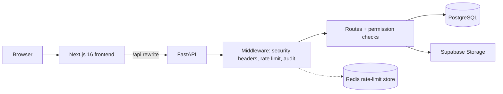

# ChikitsaX

[](https://chikitsax.amithshankar.in)
[](https://chikitsax-api.amithshankar.in/docs)

_This project was renamed. Links to the old GitHub repository redirect here._

ChikitsaX is a hospital management system that covers a patient's path through a hospital: registration, bedside charting, prescriptions, lab reports, billing, staff accounts and an audit trail. I built it to practise access control on real-shaped data: eight staff roles see different screens, different actions and, for sensitive fields, different values from the same API. The frontend is Next.js 16 with React 19; the backend is FastAPI on PostgreSQL.

## Features

- **8 staff roles:** doctor, nurse, reception, pharmacy, lab tech, hospital admin, owner and auditor. Each role gets its own dashboard panels.
- **Permission matrix:** one table maps every role to a set of permissions (`canEditCharting`, `canViewBilling`, `canManageUsers` and so on). The API checks it on every protected route, and the login response returns the same permissions so the UI renders only the actions a user may take.
- **Field-level redaction:** roles without `canViewSensitiveData` receive redacted values for sensitive patient fields instead of the raw record.
- **Patients and charting:** searchable patient registry, a chart timeline per patient (visits, vitals, notes, lab entries), prescriptions with dosage, frequency and status.
- **Lab reports:** file uploads stored in Supabase Storage with inline previews.
- **Billing:** per-patient invoices plus monthly and all-time revenue for roles allowed to see billing.
- **Audit log:** middleware records every write (`POST`, `PUT`, `PATCH`, `DELETE`). The log is paginated, filterable by user, role, action and date, and exportable to CSV. A maintenance script archives old entries.
- **Admin analytics:** monthly visits, revenue, diagnosis distribution and patient visit frequency.
- **First-login password change:** accounts created by an admin are redirected to a change-password page until they set their own password.
- **Hardening:** JWT in an HttpOnly cookie, bcrypt password hashing, security headers (nosniff, frame deny, referrer policy, HSTS in production) and Redis-backed rate limits with separate limits for login, uploads and registration.
- **Server-rendered pages:** the dashboard, patient directory and patient profile fetch their first data on the server, with `loading.tsx` skeletons per route.

The API exposes 37 REST endpoints across auth, patients, charts, prescriptions, invoices, files, users, audit log, summary and admin analytics. The full list is in the [Swagger docs](https://chikitsax-api.amithshankar.in/docs).

## Architecture



In the browser, requests go through the Next.js `/api/*` rewrite, so the auth cookie stays same-origin. Server components call the FastAPI origin directly for the first render.

## Stack

| Layer | Tools |
| :--- | :--- |
| Frontend | Next.js 16, React 19, TypeScript, Tailwind CSS, shadcn/ui (Radix), TanStack Query, TanStack Table, Zustand, React Hook Form, Zod, Recharts, Framer Motion |
| Backend | FastAPI, Pydantic v2, SQLAlchemy 2 (async, asyncpg), Alembic, python-jose (JWT), passlib + bcrypt, gunicorn |
| Data | PostgreSQL, Supabase Storage, Redis (rate limits; in-memory fallback) |
| Hosting | Vercel (frontend), Render (API), Supabase (database and storage) |

## Local setup

Requirements: Node.js 18+, pnpm 8+, Python 3.10+, PostgreSQL.

### Backend

```bash
cd Backend
python -m venv .venv
.venv\Scripts\activate          # macOS / Linux: source .venv/bin/activate
pip install -r requirements.txt
cp .env.example .env            # fill in the values below
alembic upgrade head
python seed_admin.py            # creates the first hospital admin
uvicorn app.main:app --reload   # http://localhost:8000/docs
```

### Frontend

```bash
cd Frontend
pnpm install
cp .env.example .env.local      # point NEXT_PUBLIC_API_URL at the backend
pnpm dev                        # http://localhost:3000
```

## Environment variables

### Backend (`Backend/.env`)

| Variable | Purpose |
| :--- | :--- |
| `DATABASE_URL` | Sync Postgres URL (psycopg2), used by Alembic |
| `ASYNC_DATABASE_URL` | Async Postgres URL (asyncpg), used at runtime |
| `DB_SSL_MODE` | `require` for hosted databases |
| `JWT_SECRET_KEY` | Signing key. Generate with `python -c "import secrets; print(secrets.token_hex(32))"` |
| `JWT_ALGORITHM`, `ACCESS_TOKEN_EXPIRE_MINUTES` | Token settings |
| `AUTH_COOKIE_NAME`, `AUTH_COOKIE_SAMESITE` | Auth cookie settings |
| `INITIAL_ADMIN_PHONE`, `INITIAL_ADMIN_PASSWORD` | First admin account, read by `seed_admin.py` |
| `CORS_ORIGINS` | Comma-separated allowed origins |
| `RATE_LIMIT_ENABLED`, `RATE_LIMIT_REDIS_URL`, `RATE_LIMIT_GLOBAL_IP_LIMITS` | Rate limiting; leave the Redis URL empty for in-memory storage |
| `UPLOAD_DIR` | Local upload folder when Supabase is not configured |
| `SUPABASE_URL`, `SUPABASE_SERVICE_KEY`, `SUPABASE_STORAGE_BUCKET` | Lab report storage (bucket defaults to `lab-reports`) |
| `IS_PRODUCTION` | Enables secure cookies and HSTS |
| `USE_PROXY_HEADERS` | Trust proxy headers when running behind a proxy |

### Frontend (`Frontend/.env.local`)

| Variable | Purpose |
| :--- | :--- |
| `NEXT_PUBLIC_API_URL` | Backend origin, used by the `/api` rewrite |
| `NEXT_PUBLIC_AUTH_COOKIE_NAME` | Must match the backend `AUTH_COOKIE_NAME` |
| `NEXT_PUBLIC_APP_NAME` | Display name |

## Tests

There are no automated tests yet. Adding pytest coverage for auth, the permission matrix and the audit middleware is the first item under Next steps.

## Deployment

Step-by-step settings are in [DEPLOYMENT.md](./DEPLOYMENT.md). In short:

- **Database:** Supabase Postgres, plus a public storage bucket named `lab-reports`.
- **API:** Render web service with root `Backend`, build `pip install -r requirements.txt`, start `alembic upgrade head && python seed_admin.py && gunicorn -w 4 -k uvicorn.workers.UvicornWorker app.main:app`.
- **Frontend:** Vercel project with root `Frontend`, install `pnpm install`, build `pnpm build`.

To archive audit entries older than 90 days:

```bash
python scripts/maintenance_archive.py 90
```

## Next steps

- pytest suite for login, the permission matrix, field redaction and the audit middleware.
- GitHub Actions CI: lint and build the frontend, run the backend tests.
- A seeded demo login with a switcher across the 8 roles, so visitors can see how each role's view changes.
